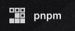
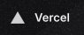
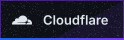
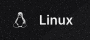
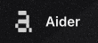
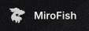
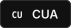
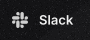

<picture>
  <source media="(prefers-color-scheme: dark)" srcset="dark_mode.svg?v=card" />
  <source media="(prefers-color-scheme: light)" srcset="light_mode.svg?v=card" />
  
</picture>

 

<b>languages</b>

  
  
  
  
  
  
  
  

 

<b>stack</b>

  
  
  
  
  
  
  
  
  
  
  
  
  
  
  
  
  
  
  
  

 

<b>harnesses</b>

  
  
  
  
  
  
  
  
  
  
  
  
  
  
  
  
  
  
  
  

 

<b>workshop</b>

  
  
  
  
  
  
  
  
  

 

<b>daily</b>

  
  
  
  
  
  
  
  
  
  
  
  

 

